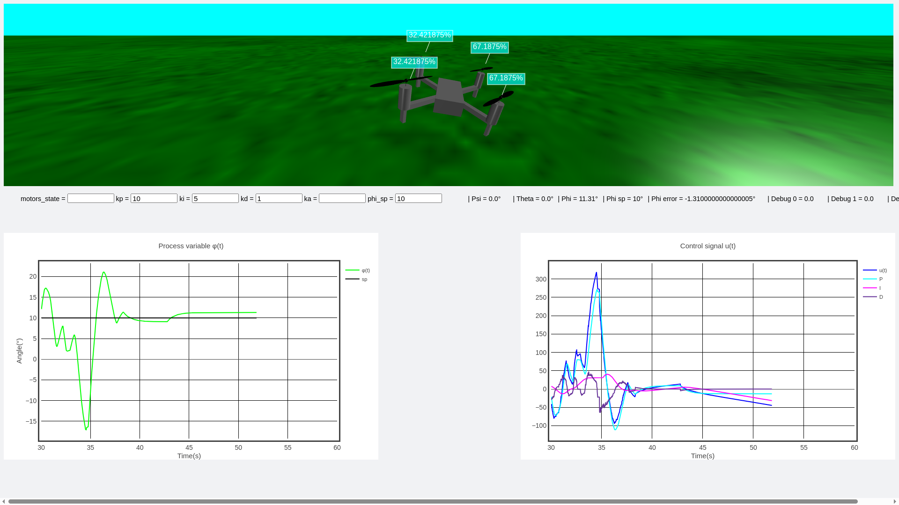
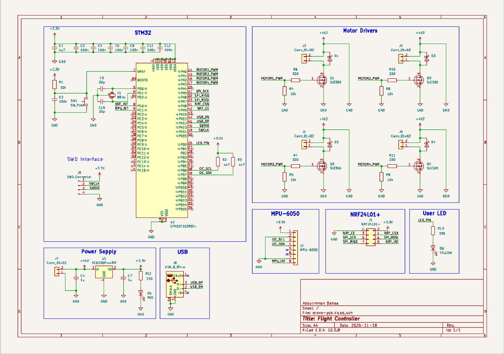

# QuadVista

<p align="center">
  
</p>

<div align="center">

**Embedded Flight Controller & Ground Station Platform for Unmanned Aerial Systems**

[](https://opensource.org/licenses/MIT)
[](https://www.python.org/)
[]()

</div>

## Overview

QuadVista is a complete unmanned aerial system (UAS) platform featuring an embedded flight controller firmware and a ground control station (GCS) application. It provides real-time telemetry monitoring, flight stability control, and intuitive UAV command interfaces for quadcopter operations.

---

## Features

### UAV Firmware

| Feature | Description |
|---------|-------------|
| **PID Control** | Proportional-integral-derivative controller for flight stability and attitude hold |
| **IMU Fusion** | Sensor fusion using MPU6050 for accurate 6-DOF orientation tracking |
| **Motor Control** | PWM-based ESC speed adjustment for quadcopter motor synchronization |
| **Telemetry** | Serial interface for real-time telemetry streaming and command exchange |

### Ground Control Station

| Feature | Description |
|---------|-------------|
| **Live Telemetry** | Real-time dashboard for altitude, orientation, and motor status |
| **Command Interface** | Intuitive UI controls for UAV operations and parameter tuning |
| **Data Visualization** | Graphical flight data display with system health indicators |
| **Flight Logging** | Persistent recording of flight parameters for post-mission analysis |

## Flight Controller PCB

<p align="center">
  
</p>

---

## Hardware Requirements

| Component | Specification | Interface |
|-----------|--------------|-----------|
| **Microcontroller** | Arduino Uno/Mega, ESP32, or compatible | -- |
| **IMU Sensor** | MPU6050 (6-axis accelerometer + gyroscope) | I2C |
| **Motors** | Coreless Motors DC x 4 | PWM via MOSFET |
| **Communication** | USB-UART bridge or Bluetooth module | Serial |

---

## Software Prerequisites

### Firmware Development

- [Arduino IDE](https://www.arduino.cc/en/software) (>=1.8.x) or [PlatformIO](https://platformio.org/)
- Wire library (built-in)
- Optional: [MPU6050 library by jrowberg](https://github.com/jrowberg/i2cdevlib)

### Ground Station

```bash
# Python 3.7+ required
pip install pyserial tkinter matplotlib
```

---

## Quick Start

### 1. Flash UAV Firmware

```bash
cd uav_firmware
# Open in Arduino IDE or PlatformIO
# Select your board and upload
```

### 2. Launch Ground Station

```bash
cd gcs_software
pip install pyserial tkinter matplotlib
python src/application.py
```

### 3. Hardware Wiring

#### MPU6050 to Microcontroller

| MPU6050 | Microcontroller |
|---------|----------------|
| VCC | 3.3V / 5V |
| GND | GND |
| SCL | SCL (A5 on Uno) |
| SDA | SDA (A4 on Uno) |

#### PWM Signal to Microcontroller

| PWM Signal | Microcontroller |
| ---------- | --------------- |
| Motor 1    | PWM Pin 9       |
| Motor 2    | PWM Pin 10      |
| Motor 3    | PWM Pin 11      |
| Motor 4    | PWM Pin 3       |

---

## Contributing

Contributions are welcome! This project is part of the [Embedded Systems Projects](https://github.com/Abdulrhman-Bahaa/embedded-systems-apps) ecosystem.

1. Fork the repository
2. Create a feature branch (`git checkout -b feature/amazing-feature`)
3. Commit your changes (`git commit -m 'Add amazing feature'`)
4. Push to the branch (`git push origin feature/amazing-feature`)
5. Open a Pull Request

Please ensure your code follows the existing style and includes appropriate documentation.

---

## License

Distributed under the MIT License. See [LICENSE](LICENSE) for more information.
